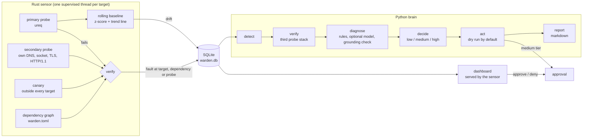

# Warden

Warden watches my live services and decides for itself what to do when one of them breaks. A Rust sensor probes each target every 30 seconds and learns its normal latency. A Python brain takes whatever the sensor raises through a six-step state machine. When the evidence holds up, the brain acts within a fixed risk tier and then writes a plain-English incident report. It currently watches the Icarus dashboard and bot, the NexusOnline webhook sender, Discord's API and johanthegoat.xyz.

The design follows one finding from the research. LLM diagnostic agents with no causal grounding [invented incidents on a healthy system 67% of the time](https://arxiv.org/abs/2605.18327). In one case an agent read its own missing tool as an outage. So in Warden, no model output can trigger an action. Every failure is cross-checked through independent probe paths and the dependency graph before anything happens.



## How a failure is handled

Each target is checked through two code paths that share nothing. The primary path is ureq. The secondary path does its own DNS lookup, opens its own socket, drives Windows' TLS stack directly and sends a hand-written HTTP/1.1 request. If only one path fails, the fault is in that path. When both fail, the sensor tries a canary address outside every target. If the canary is down too, the fault is on the probing machine. When the canary answers, the sensor checks each upstream dependency from the graph in `warden.toml`. The event it writes records whether the fault is in the target, a dependency or the probe, and which component it is.

This paid off during the build. The first real run reported `discord-api` failing on the primary path with `unable to find any user-specified roots`, while the secondary path got a 200 in 296 ms. ureq's native-tls backend had no root store configured. Without the second path, that bug in Warden itself would have been reported as a Discord outage.

The brain runs every event through `detect -> verify -> diagnose -> decide -> act -> report`. Each step writes its input, its output and its duration to the `transitions` table, and the dashboard replays them step by step. In verify, the brain probes again with a third stack, Python's urllib. If the target answers correctly now, the verdict is healthy, the incident closes, and no model is consulted.

Diagnosis is rule-based. If `--model` points at Ollama or the Anthropic API, the model may reword the hypothesis, and its claim goes through `diagnose.ground()` first. The claim must name the target, one of its dependencies or the probe. It must cite probe ids that exist and show that component failing. It cannot report a fault when every fresh probe passed. A rejected claim is quoted in the report with the reason it failed.

| Tier | Actions | Runs |
|---|---|---|
| low | re-probe, collect diagnostics, restart a target marked `stateless` | automatically (restarts only with `--live`) |
| medium | restart a target that may hold state | after Approve on the dashboard; an action still waiting runs on its own once warden.toml makes it low tier |
| high | roll back a deployment | never; the report carries a recommendation and a rollback plan |

A fix counts only when a probe taken after the action passes. The report names that probe by id. A restart that ran while the target still fails is reported as `not fixed`.

Every report also records what the incident cost: model calls, tokens in and out, probes sent, wall time and CPU time.

## Run it

You need Rust 1.85 or newer for edition 2024, and Python 3.9 or newer. The brain uses only the standard library.

```bash
cargo build --release --manifest-path sensor/Cargo.toml
```

```bash
sensor/target/release/warden-sensor check --config warden.toml
```

```bash
sensor/target/release/warden-sensor run --config warden.toml
```

```bash
cd brain && python -m warden_brain --model none
```

`check` probes every target once through both paths and prints what each one saw. `run` probes forever and serves the dashboard at http://127.0.0.1:7878. The brain runs dry until you pass `--live`. `--model ollama:llama3.2` (the default) or `--model anthropic:claude-haiku-5-5` turns on model wording. The API key goes in `ANTHROPIC_API_KEY`. If `WARDEN_TOKEN` is set, the dashboard asks for it before it records an approval.

To keep it running in the background, the watchdog starts the sensor and the brain with no console window. It restarts either one if it exits, backing off from 5 seconds to 5 minutes, and puts a shortcut in the Windows Startup folder so it comes back after every logon. Logs go to `logs/` and rotate at 5 MB. Reports from the live targets go to `incidents/`, so `reports/` keeps only the demo samples. Probes older than `retention_days` (7 by default) are pruned every hour.

```bash
python scripts/watchdog.py install
```

`status`, `stop`, `start` and `uninstall` do what they say.

If cloudflared is installed, the watchdog also opens a Cloudflare quick tunnel to the dashboard, so it can be opened from a phone. A request through the tunnel needs the key from `.warden-token`, which the watchdog creates on first start. The full link with the key is written to `logs/tunnel-link.txt`. The first visit swaps the key in the link for an HttpOnly, Secure, SameSite=Strict cookie and redirects to a clean address. Requests from the machine itself need no key. Cloudflare's headers mark a request as tunnelled even though cloudflared connects from localhost. A quick tunnel gets a new address every time it starts. Set `WARDEN_TUNNEL=0` to turn it off.

While the PC is off, asleep or offline, the cloud sentinel takes over the one fix that matters most. `.github/workflows/sentinel.yml` runs `cloud/sentinel.py` on GitHub Actions every five minutes, reading the same `warden.toml`. It probes every http target and asks Vercel's API which projects are paused, because a paused project's edge cache can keep answering 200. It unpauses each paused project once, even when several domains share it, and counts a fix only when Vercel reports the project running and a fresh probe passes. A run that leaves anything down fails, and GitHub emails the repo owner. It needs a Vercel access token in the repo secret `VERCEL_TOKEN`. Without one, the run only reports. GitHub runs schedules on a best-effort basis, so a run can start a few minutes late.

To watch a full cycle without touching anything real, run the demo. It starts two fake targets, breaks them three different ways and writes the reports below:

```bash
python scripts/demo.py --keep-running
```

## What was tested

`python scripts/check.py` runs both suites. `python scripts/check.py --install` makes it the pre-commit hook, which is how every commit in this repo was made.

The Rust suite has 24 tests. They cover config validation, which names every problem in one pass. They cover cycle detection, drift scoring and the predicted budget breach, and every branch of the fault classifier. A supervisor test checks that a panicking probe thread is restarted. Two tests drive the fake target over real sockets through both probe paths, including a mode where only the primary client gets a 500.

The Python suite has 21 tests, at least one for each numbered rule in the brief:

1. **Healthy is a valid answer.** With no events, the brain reports healthy and does nothing. A failure that rechecks healthy closes without action and without calling the model. A model that claims a fault on a healthy system is rejected.
2. **A failed probe is not an outage.** A probe-path fault never restarts the target, even in live mode. A failing dependency is blamed instead of its dependent. Claims naming components outside the graph, or citing probe ids that do not exist, are rejected.
3. **State machine.** All six states are logged in order, each with input, output and a summary. An event is handled once. Evidence for an incident stops where the previous incident on that target closed.
4. **Tiers.** A low-tier restart runs live and is skipped in a dry run. A medium-tier restart waits for approval and runs after it, and a denied one never runs. A high-tier action is never executed, even live.
5. **Cost.** Token counts from the model, probe counts and timings are stored and printed in the report.
6. **Confirmed recovery.** A restart that leaves the target failing is reported as not fixed. A fix names the probe that confirmed it. A restart that throws is reported as failed.

## Sample reports

These came from `scripts/demo.py`, which used the default model setting while Ollama was not running. Each report says so and keeps the rule-based diagnosis.

- [incident-0001-fake-api.md](reports/incident-0001-fake-api.md): the API returns 500. Confirmed by three stacks, restarted at the low tier, fixed per the next probe.
- [incident-0002-fake-api.md](reports/incident-0002-fake-api.md): only the primary probe's client gets a 500. Classified as a probe fault. The API is left alone and diagnostics are saved.
- [incident-0003-fake-worker.md](reports/incident-0003-fake-worker.md): a stateful worker stops answering. The restart waits at the medium tier until the approval arrives through the dashboard API, then runs, and the next probe confirms the fix.

## Known limits

- The sensor runs probes on OS threads rather than async tasks. With five targets on a 30-second interval that costs a handful of mostly idle threads, and the sensor needs only six direct crate dependencies.
- Of the live targets, only the fake ones in the demo have a restart configured. The Vercel sites have a rollback command for the high tier, so for them Warden recommends and never acts.
- The NexusOnline target watches the age of its outbox file. When NexusOnline is not running, Warden reports it as stopped, which is the correct reading of that state.
- The dashboard binds to 127.0.0.1. Exposing it on a network needs `WARDEN_TOKEN` and a TLS-terminating proxy in front.
- Drift alerts need 15 successful probes per target before they can fire. At the default interval that is seven and a half minutes after the first start. After a restart the sensor reloads its baseline from SQLite.
- The Kotlin companion app from the original plan is not built yet.
